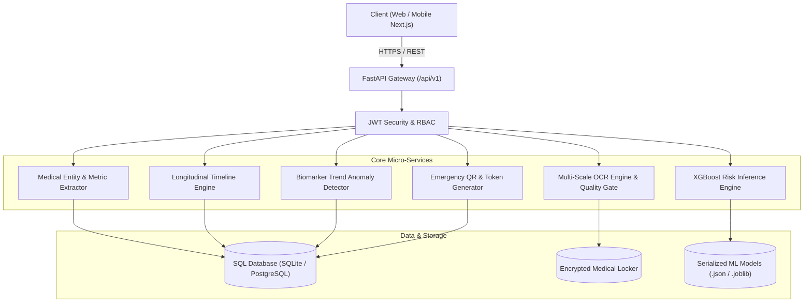

# CareTwin Backend 🏥🤖
### *AI-Powered Personal Healthcare Record (PHR) & Longitudinal Health Intelligence Platform*

[](https://fastapi.tiangolo.com)
[](https://python.org)
[](https://xgboost.readthedocs.io/)
[](https://github.com/tesseract-ocr/tesseract)
[](https://docs.pytest.org)
[](LICENSE)

---

## 🌟 Overview

**CareTwin** bridges the gap between fragmented medical records and actionable clinical intelligence. It transforms unstructured lab reports (PDFs, scans, smartphone images) into a structured, longitudinal health timeline, flags dangerous biometric anomalies using statistical trend analysis, powers emergency QR workflows for first-responders, and runs embedded machine learning models to assess patient risk.

---

## 🏗️ Architecture & System Design



---

## 🚀 Key Features & Development Milestones

### 1. 🔐 Authentication & Family Hub (Week 2)
- **JWT & Password Security**: Secure user registration, authentication, and session control using salted password hashing and Bearer tokens.
- **Multi-Profile Family Locker**: Manage multiple family members under a single primary account (e.g., dependents, elderly parents, self).

### 2. 📁 Smart Record Locker (Week 3)
- Multi-format ingestion supporting PDFs and image scans (`.png`, `.jpg`, `.jpeg`).
- Secure file storage with auto-generated UUIDs, MIME-type validation, and metadata tracking.

### 3. 🔬 Multi-Scale Medical OCR & Quality Inspection (Week 4)
- **Quality Gate**: Automatic image contrast, blur, and resolution validation (`ACCEPTED`, `WARNING`, `STORED_ONLY`).
- **Multi-Scale Tesseract Engine**: Adaptive thresholding and scale invariant binarization for low-resolution lab papers.
- **25+ Clinical Metrics Extraction**:
  - **Complete Blood Count (CBC)**: Hemoglobin, WBC, RBC, Platelets, Hematocrit, MCV, MCH, MCHC, Neutrophils, Lymphocytes.
  - **Liver & Kidney Panels (LFT / KFT)**: Creatinine, Blood Urea Nitrogen (BUN), Bilirubin, SGOT / AST, SGPT / ALT, Alkaline Phosphatase.
  - **Metabolic & Electrolytes**: Fasting Glucose, HbA1c, Sodium, Potassium, Calcium Total, Total Cholesterol, HDL, LDL, Triglycerides.
  - **Clinical Entities**: Automated detection of primary diagnosis and prescribed medications.

### 4. 📈 Longitudinal Health Timeline & Analytics (Week 5)
- Normalized chronological measurement tracking across dates.
- High-performance statistical aggregations: min, max, average, and latest readings per biomarker.
- Direct manual vitals logging endpoint.

### 5. ⚠️ Clinical Trend Detection & Anomaly Alerts (Week 6)
- **Multi-Reading Delta Analysis**: Evaluates recent biomarker trajectory against medical reference ranges.
- **Severity Classification**: Automatically triggers `MODERATE` or `CRITICAL` trend warnings with clinical descriptions (e.g., sharp creatinine spike, dangerous glycemic elevation).
- **Alert Acknowledgment**: Auditable acknowledgment workflows for patients and clinicians.

### 6. 🚨 Emergency QR Code & First-Responder Access (Week 6/7)
- **Dynamic QR Profiles**: Generate scannable QR tokens tied to life-critical health profiles (Blood Group, Allergies, Chronic Conditions, Emergency Contacts).
- **Public Emergency View**: Secure, unauthenticated access token endpoint displaying vital emergency triage cards to emergency responders in seconds.

### 7. 🤖 Machine Learning Mortality & Risk Inference (Week 7)
- **Embedded XGBoost Model**: Direct in-process machine learning inference without external microservice overhead.
- **OneHotEncoder Pipeline**: Seamless categorical preprocessing for demographics combined with real-time lab inputs (Hemoglobin, Creatinine, Potassium, BUN, Sodium, Glucose, Calcium).
- **Dynamic Risk Scoring**: Returns probability percentage, risk tiers (`lower`, `moderate`, `high`), decision thresholds, and human-readable clinical summaries.

---

## 📡 API Reference

| Endpoint | Method | Description |
|---|---|---|
| `/api/v1/auth/register` | `POST` | Register a new user account |
| `/api/v1/auth/login` | `POST` | Authenticate and obtain JWT access token |
| `/api/v1/auth/me` | `GET` | Get current user profile details |
| `/api/v1/family` | `GET` / `POST` | List and create family member profiles |
| `/api/v1/records/upload` | `POST` | Upload medical report file to locker |
| `/api/v1/ocr/process/{record_id}` | `POST` | Run OCR pipeline and persist clinical metrics |
| `/api/v1/timeline/{member_id}` | `GET` | Fetch chronological biomarker metrics |
| `/api/v1/trends/evaluate/{member_id}` | `POST` | Run trend analysis engine on recent tests |
| `/api/v1/emergency/profile` | `GET` / `PUT` | Manage patient emergency card data |
| `/api/v1/emergency/qr/generate` | `POST` | Create or refresh dynamic emergency QR code |
| `/api/v1/emergency/public/{scan_token}` | `GET` | Fast, public emergency medical data for paramedics |
| `/api/v1/predictions/schema` | `GET` | Fetch expected features and ranges for ML models |
| `/api/v1/predictions/mortality` | `POST` | Run real-time XGBoost clinical risk prediction |

---

## 🛠️ Tech Stack & Dependencies

- **Framework**: FastAPI (Python 3.11+)
- **Server**: Uvicorn (ASGI)
- **Database ORM**: SQLAlchemy with SQLite (Dev) & PostgreSQL ready (Prod)
- **Machine Learning**: XGBoost 3.x, Scikit-Learn, Joblib, SciPy, NumPy
- **Computer Vision & OCR**: Tesseract OCR, PyTesseract, Pillow, OpenCV
- **Authentication**: Python-JOSE, Passlib / Bcrypt

---

## 💻 Local Setup & Installation

### 1. Prerequisites
- Python 3.11 or higher
- [Tesseract OCR](https://github.com/UB-Mannheim/tesseract/wiki) installed on system PATH
  - *Windows default*: `C:\Program Files\Tesseract-OCR\tesseract.exe`

### 2. Clone & Environment Configuration
```bash
git clone https://github.com/shikhar3443/caretwin_backend.git
cd caretwin_backend

# Create virtual environment
python -m venv venv
# Windows:
.\venv\Scripts\activate
# Linux/macOS:
source venv/bin/activate

# Install dependencies
pip install -r requirements.txt
```

### 3. Environment Variables
Create a `.env` file in the root directory:
```env
PROJECT_NAME="CareTwin Backend"
API_V1_STR="/api/v1"
SECRET_KEY="your-super-secret-key-change-in-production"
ACCESS_TOKEN_EXPIRE_MINUTES=1440
DATABASE_URL="sqlite:///./caretwin.db"
UPLOAD_DIR="./uploads"
TESSERACT_CMD="C:\\Program Files\\Tesseract-OCR\\tesseract.exe" # Windows only
```

### 4. Run Development Server
```bash
uvicorn app.main:app --reload --host 0.0.0.0 --port 8000
```
- Interactive Swagger UI: `http://localhost:8000/docs`
- Alternative ReDoc: `http://localhost:8000/redoc`

---

## 🧪 Automated Testing

The backend includes a comprehensive automated test suite covering all major subsystems:
```bash
# Run all tests
pytest -v

# Run specific domain test suites
pytest tests/test_auth_family.py -v
pytest tests/test_records.py -v
pytest tests/test_ocr_timeline.py -v
pytest tests/test_trends.py -v
pytest tests/test_emergency_qr.py -v
pytest tests/test_predictions.py -v
```

---

## 👥 Contributors & Acknowledgements
- **Backend Architecture & Integration**: [@shikhar3443](https://github.com/shikhar3443)
- **Computer Vision & OCR Extraction**: [@Amit-11-Yadav](https://github.com/Amit-11-Yadav)
- **Machine Learning & Risk Modeling**: [@dheerajpatel003300-svg](https://github.com/dheerajpatel003300-svg)
